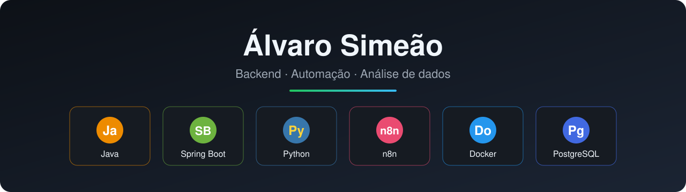
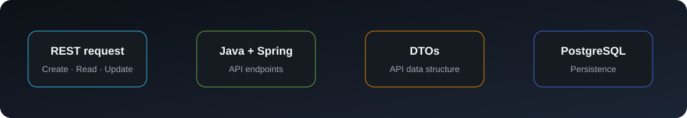
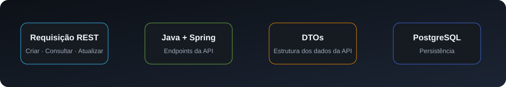
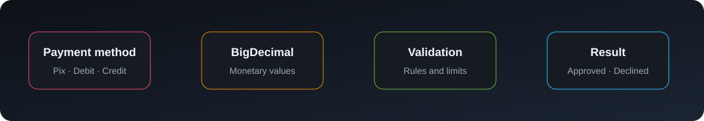
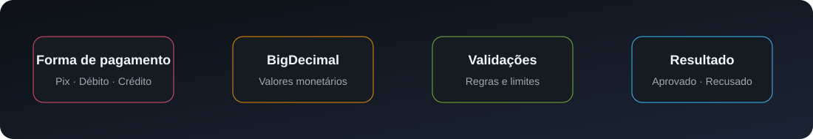
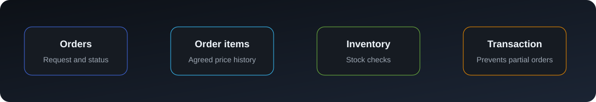

 

 

[🙋 About / Sobre](#about) · [🎯 Open to work / Vagas](#open-to-work) · [💼 Experience / Experiência](#experience) · [🎓 Certifications / Certificações](#certifications)
 
[🚀 Selected work / Projetos](#selected-work) · [🛠️ Stack / Tecnologias](#tech-stack) · [📬 Contact / Contato](#contact)

---

## 🙋 About

### Backend development · Applied AI · Automation

I study **Analysis and Systems Development at Universidade Ceuma**. I build with **Java, Spring Boot, Python, databases, and automation**, drawing on hands-on front-end experience. I am developing my skills in **applied AI and intelligent agents** alongside backend projects.

I turn business requirements into clear, testable software. The projects below are learning projects with instructions, evidence, and documented limitations.

🇧🇷 pt-BR

### Desenvolvimento backend · IA aplicada · Automação

Estudo **Análise e Desenvolvimento de Sistemas na Universidade Ceuma**. Desenvolvo com **Java, Spring Boot, Python, bancos de dados e automação**, apoiado pela experiência prática em front-end. Estou aprofundando meus conhecimentos em **IA aplicada e agentes inteligentes** junto aos projetos de back-end.

Transformo requisitos de negócio em software claro e verificável. Os projetos abaixo são trabalhos de estudo com instruções, evidências e limitações documentadas.

## 🎯 Open to work

I am **open to junior opportunities** and actively looking for my next step:

| Role | Focus |
| --- | --- |
| 📊 **Junior Analyst** | Data analysis, SQL, spreadsheets, and reporting. |
| 💻 **Junior Developer** | Back-end with Java, Spring Boot, and Python. |
| ⚙️ **Process Automation (RPA)** | Automating repetitive business workflows with n8n and Python. |
| 🤖 **AI agents and subagents** | Building intelligent agents and subagents that connect tools and automate tasks. |

Open to conversations, interviews, and technical challenges. [Reach out below](#contact).

🇧🇷 pt-BR

Estou **aberto a oportunidades de nível júnior** e em busca do meu próximo passo:

| Vaga | Foco |
| --- | --- |
| 📊 **Analista Júnior** | Análise de dados, SQL, planilhas e relatórios. |
| 💻 **Desenvolvedor Júnior** | Back-end com Java, Spring Boot e Python. |
| ⚙️ **Automação de processos (RPA)** | Automatizar rotinas repetitivas de negócio com n8n e Python. |
| 🤖 **Agentes e subagentes de IA** | Criar agentes e subagentes inteligentes que conectam ferramentas e automatizam tarefas. |

Aberto a conversas, entrevistas e desafios técnicos. [Fale comigo abaixo](#contact).

## 💼 Experience

### Software Development Apprentice · Oxygeni, Universidade Ceuma

I worked in a front-end development role and learned to understand business rules, follow deployment workflows, and communicate implementation details clearly with the team.

This experience shaped how I approach software: understand the need, explain decisions, and check the result.

🇧🇷 pt-BR

### Jovem Aprendiz em desenvolvimento · Oxygeni, Universidade Ceuma

Trabalhei com desenvolvimento front-end e aprendi a entender regras de negócio, acompanhar fluxos de deploy e comunicar detalhes da implementação com clareza para a equipe.

Essa experiência moldou minha forma de trabalhar: compreender a necessidade, explicar decisões e conferir o resultado.

## 🎓 Certifications

My [LinkedIn certifications](https://www.linkedin.com/in/alvaro-sime%C3%A3o-castelo-branco-0b1349378/details/certifications/) document coursework in:

| Area | Certified topics |
| --- | --- |
| 🏗️ **Software engineering** | Software architecture (University of Alberta) and introduction to software engineering (IBM). |
| ☕ **Java and Spring Boot** | Java backend development, Java fundamentals, Spring Boot applications, and MVC architecture. |
| 📈 **Data and AI** | SQL and relational databases; data analytics; supervised learning with regression and classification; machine learning, computer vision, and generative AI for data analysis. |
| ⚙️ **Automation** | Intelligent agents with DeepSeek and n8n. |

🇧🇷 pt-BR

Minhas [certificações no LinkedIn](https://www.linkedin.com/in/alvaro-sime%C3%A3o-castelo-branco-0b1349378/details/certifications/) registram estudos em:

| Área | Temas certificados |
| --- | --- |
| 🏗️ **Engenharia de software** | Arquitetura de software (University of Alberta) e introdução à engenharia de software (IBM). |
| ☕ **Java e Spring Boot** | Desenvolvimento backend em Java, fundamentos de Java, aplicações Spring Boot e arquitetura MVC. |
| 📈 **Dados e IA** | SQL e bancos relacionais; análise de dados; aprendizado supervisionado com regressão e classificação; machine learning, visão computacional e IA generativa para análise de dados. |
| ⚙️ **Automação** | Agentes inteligentes com DeepSeek e n8n. |

## 🚀 Selected work

These are learning projects. Each README explains the setup and how to verify the result; the diagrams below summarize the parts I worked on.

### [Student API](https://github.com/alvarosimeao/Entregaveis_Api_Arquitetura) · Java, Spring Boot, PostgreSQL

I built a REST API for student records, practicing endpoint design, DTOs, persistence, and separation between API data and stored entities. The project is an academic exercise and still needs automated tests, input validation, and a specific response for a missing student.

[Run and call the API](https://github.com/alvarosimeao/Entregaveis_Api_Arquitetura#como-executar-a-api)

🇧🇷 pt-BR

Construí uma API REST para cadastro de alunos, praticando desenho de endpoints, DTOs, persistência e separação entre os dados da API e as entidades armazenadas. É um exercício acadêmico e ainda precisa de testes automatizados, validação de entrada e uma resposta específica para aluno inexistente.

[Executar e chamar a API](https://github.com/alvarosimeao/Entregaveis_Api_Arquitetura#como-executar-a-api)

### [Java payment simulator](https://github.com/alvarosimeao/sistema-pagamentos-java) · OOP, `BigDecimal`, tests

I organized a console simulation for Pix, debit, and credit payments around shared and method-specific rules. It validates positive amounts and available balance or credit limit, prevents processing the same payment twice, and includes executable tests. It does not move real money or connect to a bank.

[Run the tests](https://github.com/alvarosimeao/sistema-pagamentos-java#como-testar)

🇧🇷 pt-BR

Organizei uma simulação de pagamentos por Pix, débito e crédito no console, separando regras comuns e específicas de cada modalidade. O programa valida valores positivos e saldo ou limite disponível, impede que o mesmo pagamento seja processado duas vezes e inclui testes executáveis. Não movimenta dinheiro nem se conecta a um banco.

[Executar os testes](https://github.com/alvarosimeao/sistema-pagamentos-java#como-testar)

### [Orders and inventory data model](https://github.com/alvarosimeao/Entregaveis_Backend) · PostgreSQL, SQL

This coursework explores relational modeling, indexes, permissions, and transactions in an orders-and-stock scenario. The order item keeps the agreed price for historical accuracy, and a transaction prevents a partial order when stock is insufficient. The sample dataset is small, so I make no performance claims.

[Run the SQL scripts](https://github.com/alvarosimeao/Entregaveis_Backend/blob/main/Modulo_Backend/Banco_de_dados/entregavel16/README.md)

🇧🇷 pt-BR

Este trabalho de curso explora modelagem relacional, índices, permissões e transações em um cenário de pedidos e estoque. O item do pedido mantém o preço acordado para preservar o histórico, e uma transação impede um pedido parcial quando não há estoque suficiente. A base de exemplo é pequena, então não faço alegações de desempenho.

[Executar os scripts SQL](https://github.com/alvarosimeao/Entregaveis_Backend/blob/main/Modulo_Backend/Banco_de_dados/entregavel16/README.md)

## 🛠️ Tech stack

| Area | Tools and practices |
| --- | --- |
| **Back-end** | &nbsp;Java &nbsp;&nbsp; &nbsp;Spring Boot &nbsp;&nbsp; &nbsp;Python |
| **Front-end** | &nbsp;React &nbsp;&nbsp; &nbsp;TypeScript &nbsp;&nbsp; &nbsp;Next.js &nbsp;&nbsp; &nbsp;Tailwind CSS |
| **Data / analysis** | &nbsp;PostgreSQL &nbsp;&nbsp; &nbsp;SQL &nbsp;&nbsp; &nbsp;Power BI &nbsp;&nbsp; &nbsp;Excel |
| **DevOps / tools** | &nbsp;Docker &nbsp;&nbsp; &nbsp;Git &nbsp;&nbsp; &nbsp;GitHub &nbsp;&nbsp; &nbsp;Postman   &nbsp;VS Code &nbsp;&nbsp; &nbsp;IntelliJ IDEA &nbsp;&nbsp; &nbsp;Vercel (deploy) |
| **Automation / AI** | &nbsp;n8n &nbsp;&nbsp; 🤖&nbsp;AI agents and subagents |

🇧🇷 pt-BR

| Área | Ferramentas e práticas |
| --- | --- |
| **Back-end** | Java · Spring Boot · Python |
| **Front-end** | React · TypeScript · Next.js · Tailwind CSS |
| **Dados / análise** | PostgreSQL · SQL · Power BI e Excel para planilhas e análise de dados |
| **DevOps / ferramentas** | Docker · Git · GitHub · Postman · VS Code · IntelliJ IDEA · fluxos de deploy com Vercel |
| **Automação / IA** | n8n · agentes e subagentes de IA |

## 📬 Contact

Connect with me on LinkedIn or send me an email.

🇧🇷 pt-BR

**Contato:** fale comigo pelo LinkedIn ou envie um e-mail pelos botões acima.

---

Icons / Ícones: <a href="https://github.com/devicons/devicon">Devicon</a> · <a href="https://github.com/simple-icons/simple-icons">Simple Icons</a> · <a href="https://github.com/microsoft/PowerBI-Icons">Microsoft Power BI Icons</a> · <a href="https://github.com/DamoBird365/microsoft-cloud-icons">Microsoft Cloud Icons</a>.

