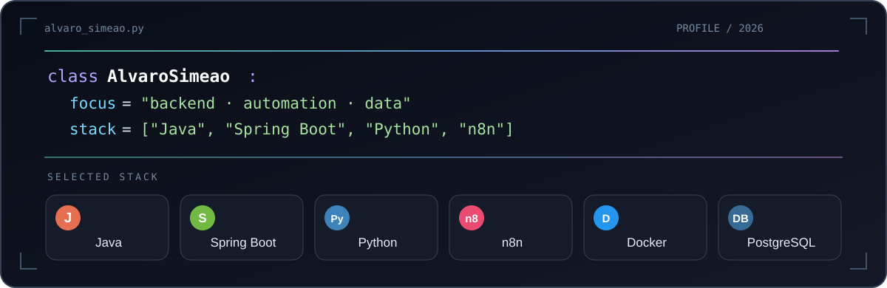

[About](#about) · [Experience](#experience) · [Projects](#featured-projects) · [Tech stack](#tech-stack) · [Contact](#contact)

## About

I am an **Analysis and Systems Development student at Universidade Ceuma**, building my path in backend development with **Java, Spring Boot, Python, databases, and automation**. I also have hands-on experience in front-end development.

I like turning business requirements into clear, testable software. The projects below are learning projects: their READMEs explain what I built, how to run or verify it, and what is still missing.

🇧🇷 Ler apresentação em português

Sou estudante de **Análise e Desenvolvimento de Sistemas na Universidade Ceuma** e estou construindo minha trajetória em desenvolvimento backend com **Java, Spring Boot, Python, bancos de dados e automação**. Também tenho experiência prática em desenvolvimento front-end.

Gosto de transformar regras de negócio em software claro e verificável. Os projetos abaixo são trabalhos de estudo: seus READMEs explicam o que construí, como executar ou verificar e o que ainda falta.

**Experiência:** trabalhei como Jovem Aprendiz em desenvolvimento na **Oxygeni, da Universidade Ceuma**. Nesse período, aprendi sobre regras de negócio, fluxo de deploy e comunicação clara com a equipe.

**Projetos:** [API de alunos](https://github.com/alvarosimeao/Entregaveis_Api_Arquitetura) · [Simulador de pagamentos](https://github.com/alvarosimeao/sistema-pagamentos-java) · [Pedidos e estoque](https://github.com/alvarosimeao/Entregaveis_Backend).

**Tecnologias:** Java, Spring Boot, Python, n8n, SQL, PostgreSQL, Docker, Git, GitHub e análise de dados com planilhas. Também uso TypeScript, React e Next.js em front-end.

## Experience

**Software Development Apprentice · Oxygeni, Universidade Ceuma**

I worked in a front-end development role and learned how to understand business rules, follow deployment workflows, and communicate implementation details clearly with the team. This experience shaped how I approach software beyond the code: understanding the need, explaining decisions, and checking the result.

## Featured projects

| Project | What it shows | How to verify |
| --- | --- | --- |
| **[Student API](https://github.com/alvarosimeao/Entregaveis_Api_Arquitetura)** | Java, Spring Boot, PostgreSQL, REST endpoints, DTOs, and separation of responsibilities. | [Run and call the API](https://github.com/alvarosimeao/Entregaveis_Api_Arquitetura#como-executar-a-api) |
| **[Java payment simulator](https://github.com/alvarosimeao/sistema-pagamentos-java)** | Object-oriented design, `BigDecimal`, payment validation, and executable tests. No real transactions. | [Run the tests](https://github.com/alvarosimeao/sistema-pagamentos-java#como-testar) |
| **[Orders and inventory data model](https://github.com/alvarosimeao/Entregaveis_Backend)** | PostgreSQL modeling, indexes, permissions, and transactions in an academic scenario. | [Run the SQL scripts](https://github.com/alvarosimeao/Entregaveis_Backend/blob/main/Modulo_Backend/Banco_de_dados/entregavel16/README.md) |

Technical decisions and current limits

- **Student API:** DTOs separate API data from the persisted entity. It still needs automated tests, input validation, and specific HTTP handling for missing students.
- **Payment simulator:** `BigDecimal` handles monetary values; executable tests cover approvals, refusals, and repeated processing. It has no persistence or banking integration.
- **Orders and inventory:** the order item stores the agreed price to preserve history; a transaction prevents partial orders when stock is insufficient. The sample data is too small to support performance claims.

## Tech stack

| Area | Tools and practices |
| --- | --- |
| **Back-end** |  Java &nbsp;  Spring Boot &nbsp;  Python |
| **Front-end** |  React &nbsp;  TypeScript &nbsp;  Next.js |
| **Data / analysis** |  PostgreSQL &nbsp;  SQL &nbsp; 📊 Spreadsheets / data analysis |
| **DevOps / tools** |  Docker &nbsp;  Git &nbsp;  GitHub &nbsp; 🚀 Deployment workflows |
| **Automation** |  n8n |

## Contact

